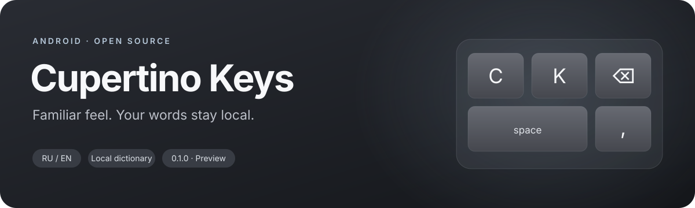
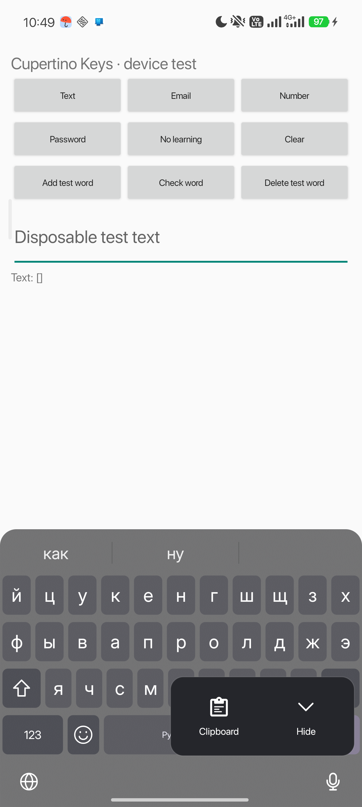
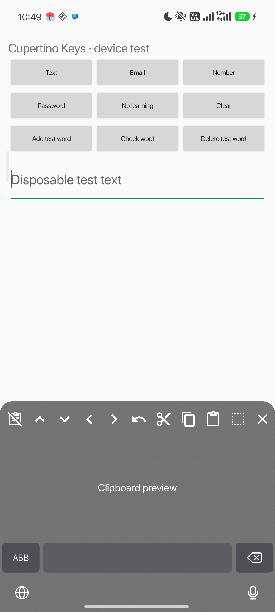

<p align="center">
  
</p>

<p align="center">
  <strong>Привычный вид. Русский и английский. Словарь на вашем устройстве.</strong><br>
  Независимый форк HeliBoard · Android · GPL-3.0 · Ранняя версия 0.1.0
</p>

<p align="center">
  <a href="#возможности">Возможности</a> ·
  <a href="#установка">Установка</a> ·
  <a href="#совместимость">Совместимость</a> ·
  <a href="#приватность">Приватность</a> ·
  <a href="#сборка">Сборка</a>
</p>

---

**Cupertino Keys** — клавиатура для Android с оформлением в духе iOS: плоские клавиши, светлая и тёмная темы, полупрозрачный фон и лаконичные элементы управления. В основе — движок [HeliBoard](https://github.com/HeliBorg/HeliBoard), локальные словари и подсказки.

> [!IMPORTANT]
> **Основное тестирование и настройка выполнены на Xiaomi 14 с Android 16 / HyperOS.** На других телефонах, версиях Android и оболочках внешний вид, размытие, отступы, жесты и поведение клавиатуры могут отличаться. Это ранняя версия, а не гарантия одинаковой работы на всех устройствах.

## Возможности

| | Что умеет клавиатура |
| :-- | :-- |
| **Оформление** | Плоские клавиши, скруглённый верх, шрифт Inter, светлая и тёмная темы. |
| **Прозрачность** | Системное размытие на поддерживаемых устройствах. Оттенок зависит от содержимого под клавиатурой; если размытие недоступно, используется непрозрачный фон. |
| **RU / EN** | Русский и английский по умолчанию. Переключение языка свайпом по пробелу. |
| **Пунктуация** | Запятая справа от пробела. Удержание запятой вводит точку. |
| **Подсказки** | Локальные словари и персональные слова. Место под подсказки сохраняется, чтобы поле сообщения не прыгало при вводе. |
| **Нижняя панель** | Глобус слева, микрофон справа. Удержание микрофона открывает меню «Буфер / Свернуть».¹ |
| **Диктовка** | Компактная панель над микрофоном, без смены клавиатуры и высоты поля ввода. Распознавание через службу Google. |
| **Буфер обмена** | История нескольких записей, вставка, закрепление и удаление. Включается по желанию; проверена работа с пятью записями. |
| **Отклик** | Настраиваемые звук и вибрация с учётом системного беззвучного режима и «Не беспокоить». |
| **Эмодзи** | Отдельная кнопка со смайлом. Удержание Enter не открывает меню эмодзи. |

¹ Своя нижняя панель работает в поддерживаемом режиме жестовой навигации Android 16. В других конфигурациях остаётся системная панель; буфер доступен через панель инструментов.

Компактная диктовка описывает текущую ветку разработки. Опубликованный релиз `v0.1.0` использует внешнюю панель Google Voice Typing.

<details>
<summary><strong>Скриншоты с Xiaomi 14: меню микрофона и буфер</strong></summary>
<br>
<p align="center">
  
  &nbsp;
  
</p>

Снимки сделаны в тестовом приложении на Xiaomi 14. Записи буфера скрыты для снимка; подписи меню на английском из-за языка системы. Прозрачный фон выглядит по-разному в разных приложениях. Баннер выше — иллюстрация, эти снимки — реальный интерфейс.

</details>

## Установка

1. Установите APK Cupertino Keys. Если готовой сборки ещё нет в **Releases**, её можно собрать из исходников по инструкции ниже.
2. Откройте приложение, включите клавиатуру в настройках Android и выберите **Cupertino Keys** текущей.
3. Настройте звук, вибрацию и, при необходимости, историю буфера.
4. Для локальной проверки орфографии выберите **Cupertino Keys** в системном разделе «Проверка орфографии». В старых сборках служба называлась **HeliBoard SpellChecker**. Выбор клавиатуры сам по себе не меняет системный корректор.
5. Для диктовки нажмите микрофон справа внизу и разрешите доступ к микрофону. После первого разрешения нажмите кнопку ещё раз. Нужна установленная служба распознавания Google; если её публичный интерфейс недоступен, используется включённая клавиатура **Голосовой ввод Google**.

Текущая сборка — **development APK**, пакет `dev.cupertinokeys.keyboard.debug`. Она может быть установлена рядом с HeliBoard. Обновление с сохранением данных требует той же подписи APK; локальные и CI-сборки могут иметь разные подписи. Удаление приложения стирает его локальные данные.

## Совместимость

| Устройство / режим | Что проверялось |
| :-- | :-- |
| **Xiaomi 14 · Android 16 · HyperOS** | Основное устройство. Ввод RU/EN, свайп пробела, пунктуация, подсказки, геометрия окна, нижняя панель, буфер, темы и размытие. Пользователь подтвердил звук, вибрацию и вставку текста через Google Voice Typing. |
| **Xiaomi Mi 8 · Android 10 · MIUI 12** | Базовый ввод и локальный словарь проверялись на более ранней сборке. Это не проверка всех возможностей текущей версии. |
| **Рабочий профиль Shelter** | Пользователь подтвердил работу общей клавиатуры и словаря на Xiaomi 14. Автоматические проверки рабочего профиля ограничены HyperOS. |
| **Другие устройства** | Не проверены. Возможны отличия, ошибки и необходимость настройки. |

Минимальная версия в проекте — Android 5.0 (API 21). Она не означает, что все функции доступны или протестированы начиная с этой версии: системное размытие требует поддерживаемого Android 12+, своя нижняя панель — Android 16 и подходящий режим навигации.

### Личный и рабочий профили

Установите клавиатуру в личном профиле и используйте её также в рабочих приложениях. В стандартном рабочем профиле Android используется общий метод ввода, поэтому настройки и словарь принадлежат одному экземпляру клавиатуры. Устанавливать второй экземпляр ради синхронизации не нужно: у него будет отдельное хранилище.

Политики администратора могут ограничивать доступные клавиатуры. Xiaomi Second space и отдельные пользователи Android не равнозначны этому режиму. Подробности — в [инструкции проверки профилей](docs/DEVICE_TESTING.md#work-profile-on-xiaomi-14).

## Приватность

- **Без разрешения на интернет.** Cupertino Keys не отправляет набранный текст, словарь или историю буфера на серверы.
- **Личный словарь хранится внутри приложения.** Нет доступа к контактам и общему пользовательскому словарю Android; локальный провайдер не экспортируется.
- **Резервное копирование отключено.** Данные исключены из стандартных механизмов Android backup и переноса; поведение сторонних средств миграции требует отдельной проверки.
- **История буфера — по выбору.** По умолчанию выключена; стандартный срок хранения — час. Сбор ограничен для паролей, режима без обучения и записей, отмеченных как чувствительные.
- **Диктовка использует службу Google.** Для компактной панели Cupertino Keys запрашивает доступ к микрофону только после нажатия кнопки. Аудио не сохраняется приложением, но Google может отправлять его на свои серверы: это не обещание офлайн-диктовки. При закрытии панели, скрытии клавиатуры, переходе в другое поле или продолжении печати диктовка отменяется.

Введённый текст, разумеется, передаётся приложению, в котором вы печатаете. Ручной экспорт данных выполняется только по действию пользователя.

## Сборка

Нужны JDK 21, Android SDK 37 и NDK `28.0.13004108`. Версии зависимостей зафиксированы в проекте; рабочая ветка — `cupertino`.

```sh
# Linux / macOS; в Windows используйте .\gradlew.bat
./gradlew :app:assembleDebugNoMinify -Pandroid.injected.testOnly=false
python tools/check_privacy.py --merged
```

APK появится в `app/build/intermediates/apk/debugNoMinify/`.

<details>
<summary><strong>Локальные проверки и сборка в Windows</strong></summary>

Для подготовленного Windows-окружения с инструментами в `.tools`:

```powershell
powershell -ExecutionPolicy Bypass -File tools/build-local.ps1 -Task Build
powershell -ExecutionPolicy Bypass -File tools/build-local.ps1 -Task Test
python tools/check_privacy.py --merged
```

Скрипт использует проверенное сопоставление диска `K:` для обхода ограничений NDK на пробелы и `!` в пути. Сам инструменты не скачивает. Требования к окружению и команды Gradle — в [технических заметках](docs/PROJECT_NOTES.md#build-and-verify).

Последняя локальная проверка: **24 JVM-теста**, проверки приватности двух итоговых манифестов и проверки на Xiaomi 14. Автотесты на телефоне обращаются к представлениям приложения; они не заменяют проверку физических касаний и всех сторонних приложений.

[Как повторить проверки](docs/DEVICE_TESTING.md) · [Отчёты по устройствам](docs/testing)

</details>

## Обратная связь

Если что-то выглядит или работает иначе, приложите к issue модель телефона, версии Android и оболочки, версию сборки, режим навигации и шаги воспроизведения. Скриншот лучше делать с тестовым текстом, без личной переписки и содержимого буфера.

## Основа и лицензии

Проект основан на [HeliBorg/HeliBoard](https://github.com/HeliBorg/HeliBoard), исходная версия **v4.2**, коммит `0c60dffb03a4e2e7a37cb82210f5299f93c03979`. Сохранены исходные лицензии и история доступной базовой версии. Изменения этого форка сделаны с помощью AI.

- Код: [GPL-3.0](LICENSE); части AOSP — [Apache-2.0](LICENSE-Apache-2.0).
- Исходная иконка HeliBoard: [CC BY-SA 4.0](LICENSE-CC-BY-SA-4.0).
- Шрифт Inter: [SIL Open Font License](app/src/main/assets/fonts/OFL.txt).
- [Исходная документация и благодарности HeliBoard](README.upstream.md).

Cupertino Keys — независимый проект, не продукт Apple и не официальный выпуск HeliBoard. Оформление вдохновлено iOS, но не является её точной копией. Шрифты и графические ресурсы Apple в проект не включены.
