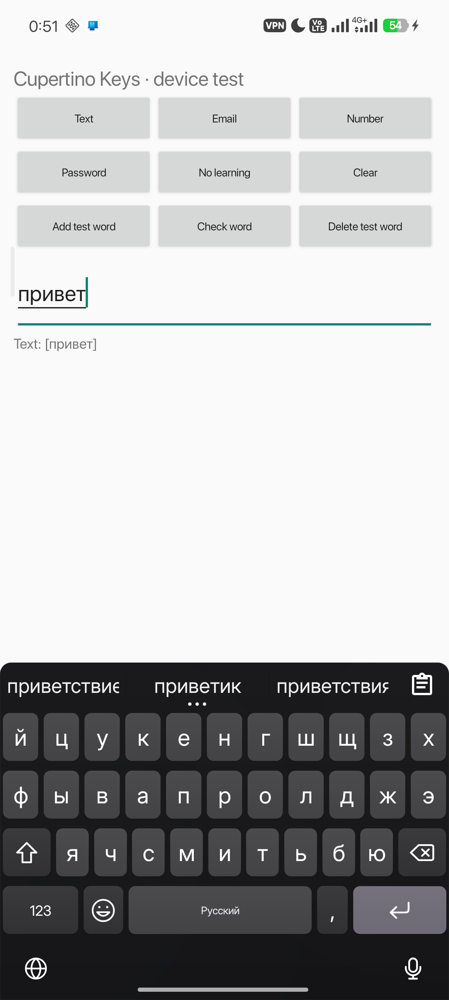
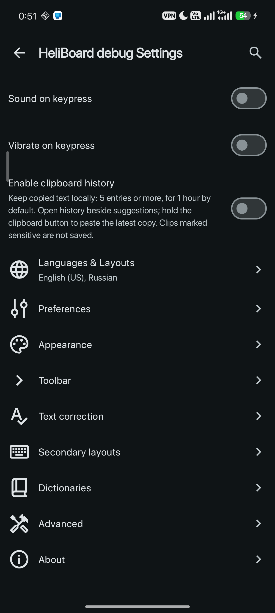
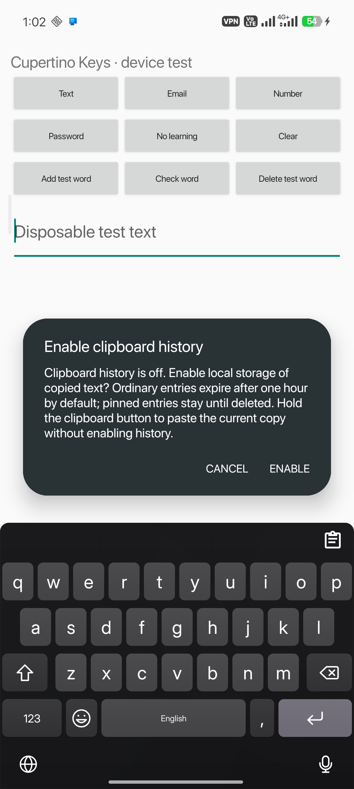

# Graphite theme, feedback controls, and clipboard — Xiaomi 14

The dark surface is now neutral graphite (#19191B to #141416) with much subtler
color overlays. Keycaps use neutral grays. The normal IME uses a painted material,
not live transparency or a sampled application background.

The settings home now exposes the existing sound, vibration, and history controls.
History remains opt-in. A clipboard button is pinned beside suggestions by default;
existing user toolbar customizations are respected. Text history defaults to one-hour
retention and supports more than five entries; existing retention settings remain.
File collection defaults off. Sensitive-marked clips and copies made in password,
no-learning, or incognito fields are excluded from collection.

Device instrumentation passed 15 assertions: five real system clipboard copies,
five list-item insertions into the editor, pinned-button visibility, sound/vibration
settings, disabled collection, and sensitive/password/no-learning exclusions.
Test entries were removed after completion. Light/dark screenshots were captured in
the disposable test Activity. No microphone, network, or additional permissions added.

An initial test could not restore a pre-existing URI image clip because Android
denied re-granting its provider URI. The user was informed that it must be copied
again. The runner now refuses URI/intent clips before modifying the clipboard and
guarantees preference/history cleanup even if clipboard restoration fails.

The user subsequently confirmed both sound and vibration work after turning off
Do Not Disturb and silent mode. Copying across Shelter's clipboard policy remains
a manual check. The shared personal IME setup is unchanged.

All 23 selected JVM tests passed; source/merged-manifest privacy checks passed.
APK signatures v1/v2 verified. Installed in the personal profile on Xiaomi 14.
Deliverable: `build/deliverables/CupertinoKeys-0.1.0-clipboard.apk`.
SHA-256: `a0b9ecf59eb6e13b2a3158c03d9fdd836358091484f15a1dfeba0314ff362f3e`.

## Follow-up: inactive-looking clipboard button and silent feedback

On the device, sound and vibration preferences were both enabled, while zen_mode was
1. Clipboard history was disabled. Upstream maps a clipboard tap to immediate paste
when history is disabled, so an empty system clipboard produced no visible response.

The button now offers to enable local history, then opens its panel. Cancel keeps
history disabled. Long-press still pastes the current system clip. An empty panel
now explains how to populate and use it. The settings home shows the active sound
policy and provides the existing opt-in vibration-in-DND switch; global sound policy
is never changed by the app.

The `clipboard_access` device phase passed 13 assertions, dispatching DOWN/UP through
the decor view, checking the reported IME touch region, cancellation, preference
persistence, and panel visibility after enabling. It does not overwrite the system
clipboard. The test Activity now repairs input only on its first focus: previously
it restarted input when the dialog closed and incorrectly reset the selected panel.

The user confirmed the button opens history after enabling on Xiaomi 14.
Follow-up APK: `build/deliverables/CupertinoKeys-0.1.0-clipboard-fix.apk`.
SHA-256: `a5d6fe0acd680ea55804817b03b627113e499d120a97c0a9bb0aca163b502c82`.
