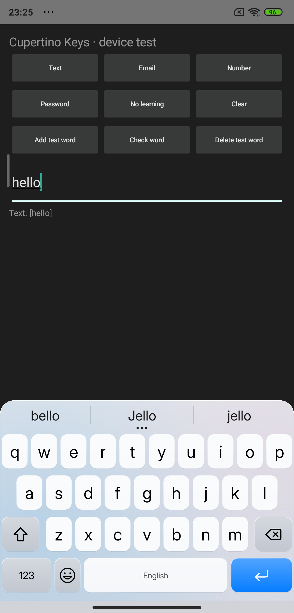
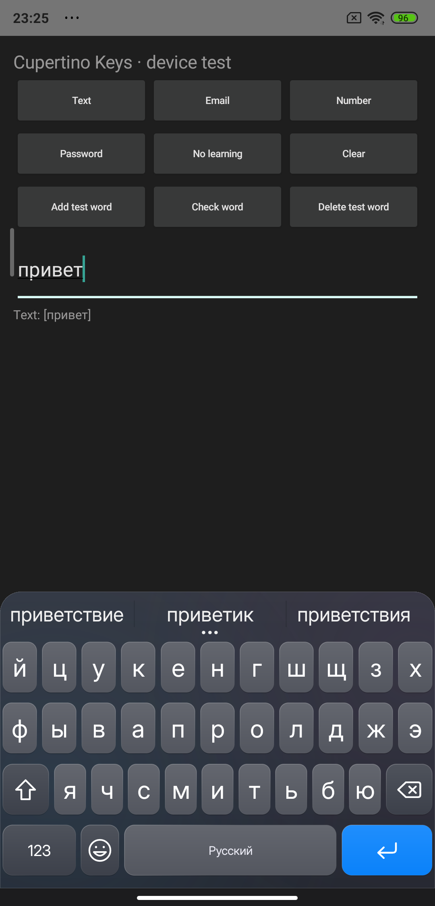

# Cupertino visual pass — 2026-11-20

Verified on Mi 8 / Android 10 / MIUI V12.0.3.0.QEAMIXM.

Historical report: the later [Xiaomi 14 checks](xiaomi14-2026-11-21.md) found and fixed
two defects in the previously untested native blur branch. The normal IME now uses
the frosted fallback, and Android 16 has a custom bottom navigation panel.

Final local APK SHA-256:
`521cff9f7c12dab4c87eb87e9c4c68759c2a27b31aa82cfcec2074555e84fe44`.

## Changes

- Bundled Inter, with Latin and Cyrillic coverage and an included SIL OFL license.
  Letter scale is 84% and default keyboard height 94% of the upstream values.
- Rounded 9 dp keycaps with subtle gradients, edge highlights and pressed states.
- Rounded frosted keyboard surface, lighter outlines and original thin icons.
- Wider spacebar and simplified phone bottom row. Comma and period remain accessible
  through symbol layouts; email and URL fields retain their special keys.
- Public Android 12+ window blur with a keyboard-bounded background outline,
  availability listener and an opaque fallback when blur is unavailable.
- Force Dark disabled at the IME window theme, decor and custom view levels.

## Verification

The first light preview exposed an MIUI behavior: the palette, KeyDrawParams and
selected text color were all black, but text appeared white on the device. Disabling
Force Dark only on child views was insufficient. Applying an explicit IME window
theme fixed the visible output. Both screenshots below were inspected after that fix.

The 19 on-device input/dictionary assertions and all 18 Robolectric cases passed
after the IME theme fix. APK assembly and privacy checks passed. No network permission
or screenshot capture API was added to the production keyboard. Screenshot capture
in the debug test script uses ADB only while our disposable input screen is displayed.

The native blur branch cannot run on Android 10 and **has not been physically verified
on Xiaomi 14 yet**. These Mi 8 screenshots show the procedural frosted fallback,
not a sampled or blurred image of another application. Android system blur availability
can change at runtime; the implementation returns to an opaque material in that case.
See [Android's window blur documentation](https://source.android.com/docs/core/display/window-blurs).

This is still an approximation of iOS 26. Inter is not Apple's SF font, the emoji key
remains in the bottom key row, and the iOS accessory area and optical refraction are
not reproduced. Physical gesture feel, landscape and Xiaomi 14 remain to be checked.

Reproduce previews with:

```powershell
python tools/test-device.py --serial SERIAL --adb .tools/android-sdk/platform-tools/adb.exe --screenshots
```

## Light English



## Dark Russian


