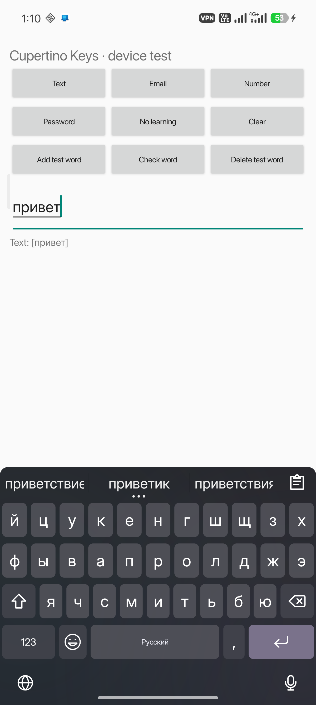
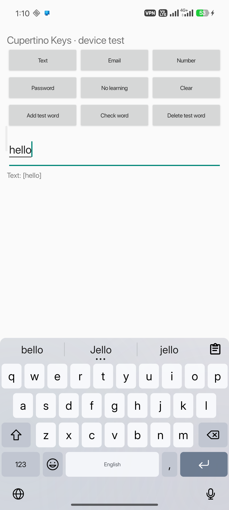

# Flat keys and a softer material — Xiaomi 14

Compared the user's supplied reference with Apple's current iOS page and historical
native-keyboard examples from KeyboardKit. Apple's current page is iOS 27; the
KeyboardKit article is explicitly an iOS 26 beta reference, not a current-release
specification. The user photo remains the main visual target.

- [Apple iOS](https://www.apple.com/os/ios/)
- [Apple image showing the keyboard's upper surface](https://www.apple.com/v/os/g/images/shared/highlights/siri_conversations__dxav283qboae_large.jpg)
- [KeyboardKit: native iOS keyboard and Liquid Glass](https://keyboardkit.com/blog/2025/07/28/custom-ios-keyboard-extensions-and-liquid-glass)

Removed the separate drop shadow, bevel stroke, bright rim, and vertical gradient
from each key. A single stateful fill now draws the key, using 205/255 opacity in
dark mode and 244/255 in light mode so the shared material can subtly tint it.
Pressed keys still change brightness. Hit boxes and keyboard layout are unchanged.

Replaced the nearly black dark background with smoky charcoal and broad, subdued
cool/warm tones. Reduced the blue/pink tint in light mode. Native blur restrictions
are unchanged: this is a locally painted background, not transparency into another
application, and does not capture or sample application content. No Apple assets
are bundled into the keyboard.

## Verification

Build succeeded and installed on Xiaomi 14 / Android 16. Light English and dark
Russian device previews passed their IME checks; both screenshots were inspected
for flat fills and text contrast. No new unit tests were added for this drawable-only
change. APK signatures v1/v2 verified.

Deliverable: `build/deliverables/CupertinoKeys-0.1.0-flat.apk`.
SHA-256: `75d02188316b27e6e2b8bf2c32d96c24d24852aa8b686f762fb9067c92f071a1`.

