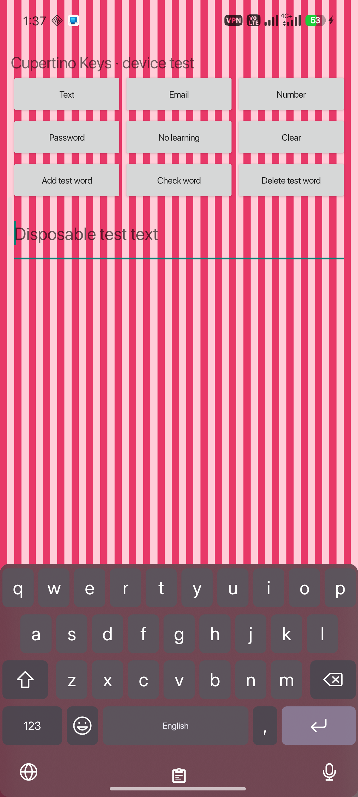
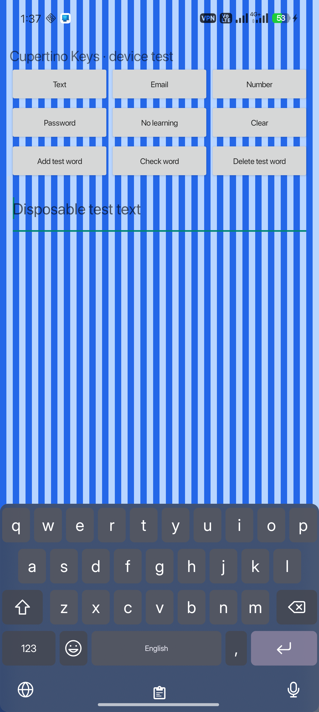

# Native glass and automatic suggestion row

Device: Xiaomi 14, Android 16 / API 36, HyperOS OS3.0.305.0.WNCMIXM.

This supersedes the native-blur restriction and simulated color wash described in
earlier visual reports. Applying blur to the full-height IME window affects the app
above the keyboard. The new implementation leaves that window transparent and uses
a `TYPE_APPLICATION_MEDIA` child behind it, sized exactly to `main_keyboard_frame`.
The child is neither focusable nor touchable. It follows layout changes and is
removed when the IME hides or is destroyed. Vendor failures fall back to an opaque
neutral surface. Floating/fullscreen modes also use the fallback.

This uses public APIs: [Android background blur](https://source.android.com/docs/core/display/window-blurs)
and [media subwindows](https://developer.android.com/reference/android/view/WindowManager.LayoutParams#TYPE_APPLICATION_MEDIA).
No overlay, screen-capture, accessibility, network, or microphone permission was added.
The Android compositor processes underlying surfaces; the keyboard never reads their
pixels. Actual tint depends on what the application draws underneath its IME area.

## Evidence

The debug-only disposable Activity draws alternating 24 px stripes across its own
window, first red/pink and then blue. These are sharp above the keyboard and blurred
beneath it. The footer's average RGB over x=220..469, y=2580 changes from approximately
(113, 71, 83) to (64, 81, 114). Residual per-channel variation there is only 2–3 levels,
despite the high-contrast stripes. This demonstrates both background adaptation and
actual blur, rather than a fixed purple gradient or plain unblurred transparency.

WindowManager reports the compact child at `[0,1889][1200,2670]`, size 1200×781,
with `NOT_FOCUSABLE NOT_TOUCHABLE`. The IME's inset coordinate origin is 134 px below
the display origin: positioning the child uses screen coordinates to avoid an
incorrect 134 px blur band above the keyboard. The host keeps zero background padding.

## Suggestions and clipboard

On the Android 16 Cupertino bottom-panel layout, no word candidates means the entire
120 px suggestion row is `GONE`. Candidate arrival increases the frame from 781 to
901 px; deleting the word restores 781 px. A typed word alone or punctuation placeholders
do not count as candidates. Explicit toolbar, external suggestions, emoji categories,
and clipboard controls retain their rows. While the word row is collapsed, the history
button is available between the globe and microphone; hold it to paste the current clip.
Older navigation layouts keep the original row and clipboard access.

Clearing a composing word from the application (as after sending a message) previously
left stale engine state because position zero was considered inside the old word.
An empty-editor check now resets composition and candidates. Moving the cursor to the
start of a nonempty field does not trigger that reset.

## Validation

- 22 selected JVM regression cases pass; privacy check passes for both merged manifests.
- Device input and dictionary persistence: 19 assertions, including RU/EN, space swipes,
  deletion, numeric/password/no-learning fields, and cleanup of the disposable word.
- Dynamic suggestions: 15 assertions, including exact height changes, app-driven clear,
  fresh typing after clear, clipboard access, and blur removal/restoration on hide/show.
- Geometry: 4 assertions; navigation: 12; clipboard enable/cancel/access: 13.
- Warm/cool blur probes: 3 assertions each. Light/dark previews and dark emoji panel
  inspected; labels remain legible and the emoji category row shares the same surface.
- The old unit assertion about forbidding full-height host blur was removed with its
  obsolete guard. Child bounds are now independently verified using WindowManager
  and the physical-device probes; the existing padding/inset regression tests remain.

HyperOS blocks system-wide touch injection, so device checks dispatch events through
our own IME views. System blur is reported supported and enabled. Attempting to toggle
it for a fallback test was denied by `WRITE_SECURE_SETTINGS`; readback confirmed it
remained enabled. A live system-disable transition was therefore not physically tested.
Mi 8 and a separate work-profile installation were not tested in this change.

Deliverable: `build/deliverables/CupertinoKeys-0.1.0-glass.apk`.
Installed over the existing personal-profile app, retaining its settings and dictionary.
Signature verified (v1/v2); four ABIs included. SHA-256:
`2bb38ceb0856dffdac5c1007216830e6b99251446e5fef9893ca58dd0ae23ce6`.
