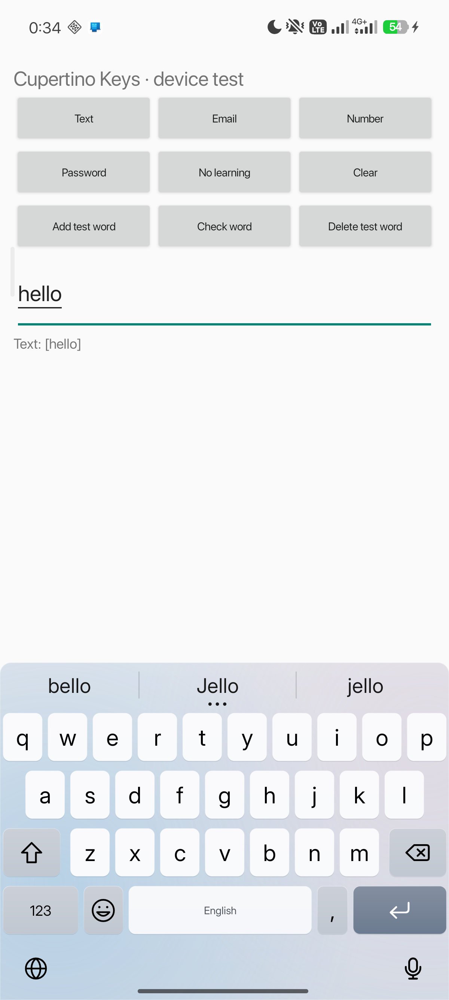
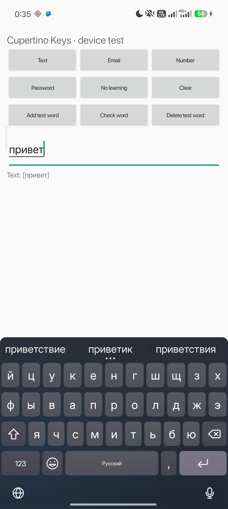
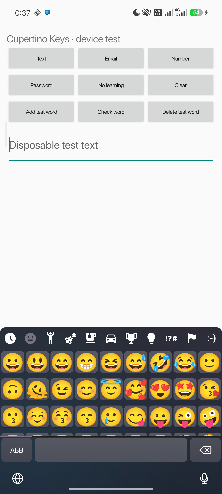

# Reference styling, voice input, and emoji theme — Xiaomi 14

Device: Xiaomi 14, Android 16 / API 36, HyperOS OS3.0.305.0.WNCMIXM.

The Cupertino theme now uses shorter, flatter keycaps, smaller labels, and a muted
action-key color. The bottom-left globe remains in the accessory row; the right
button opens enabled Google Voice Typing. Holding it hides the keyboard. Password
and no-learning fields show the hide icon instead. The comma remains right of space.

The emoji category strip previously inherited a light XML background even in the
dark theme. It now receives the theme's strip background, matching the surface below.

## Verification

- Local build succeeded; 23 selected JVM cases passed for dictionary storage,
  defaults, input privacy, and window geometry.
- Physical device instrumentation: input/persistence 19 assertions, navigation 12,
  geometry 4, Google voice eligibility 7, and emoji themes 6; all passed.
- Light/dark alphabet and emoji screenshots inspected. Emoji categories are legible
  and the dark panel no longer has a light band.
- Source and merged-manifest privacy checks passed. Cupertino requests neither
  INTERNET nor RECORD_AUDIO; voice recognition is delegated to Google's enabled IME.
- The root has no background padding. The main keyboard frame is 1200×901 at
  y=1635 in a 1200×2536 root, including a 144 px accessory row. Key view and occupied
  height both measure 637 px, with no duplicate navigation padding.

Tests dispatch events through Cupertino's views; HyperOS still blocks shell touch
injection. The user confirmed Google voice input opens and dictated text is inserted. Google
may process audio online; dictionary storage remains local. Work-profile typing and
shared dictionary were previously user-confirmed; Google voice in Shelter has not
been independently verified. Native blur remains disabled for the normal full-height
IME window because it would blur application content above the keyboard.

Deliverable: `build/deliverables/CupertinoKeys-0.1.0-voice.apk`.
SHA-256: `ed212c70dcc86962f0c3f66b1587713640f2d85cfe8fdee2b3e46d08d9c7a660`.

## Screenshots

Only the disposable test Activity is shown.

