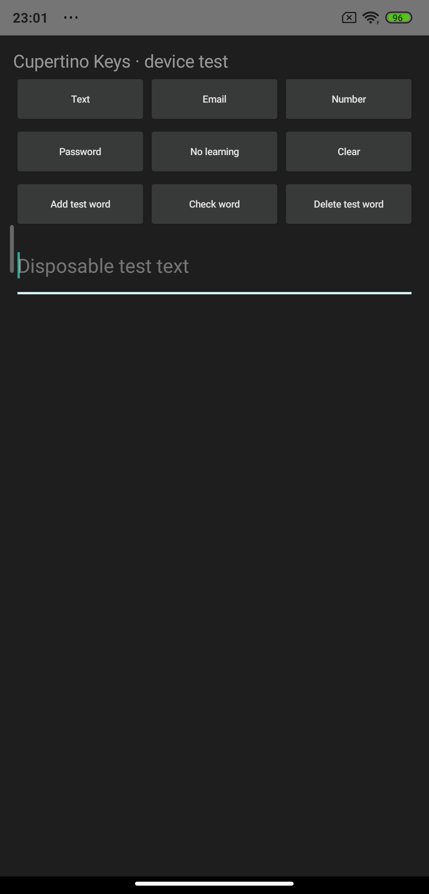

# Mi 8 device verification — 2026-11-20

Device: Xiaomi Mi 8, Android 10 / API 29, MIUI V12.0.3.0.QEAMIXM, arm64-v8a.
Build: Cupertino Keys 0.1.0 debugNoMinify, built locally from the `cupertino` branch.
APK SHA-256: `28604349bf466e66808fc216e85e9abb78a590c8d68b4e0a8e58789d9f631237`.

## Passed

- Local APK assembly and source/merged-manifest privacy checks.
- 18 Robolectric cases across API 29 and 36 on JDK 21: dictionary behavior,
  initial language settings, and changes to no-learning flags.
- 19 physical-device assertions in two instrumentation process launches:
  visible IME, Russian and English typing, space insertion, language switching
  in both directions without insertion, backspace, cancelled touch, small movement,
  numeric/password/no-learning input, password learning/suggestion restrictions,
  no-learning flag handling, duplicate-free personal word insertion, persistence,
  and deletion. The visibility assertion runs in both launches.
- External ADB query to the personal dictionary rejected with SecurityException
  because the provider is not exported.
- Installed permissions contain no INTERNET, contacts or shared-dictionary access.
- Dark portrait layout rendered on the device; screenshot below.

The device test exposed a real issue inherited from the engine: changing only
IME_FLAG_NO_PERSONALIZED_LEARNING during restartInput reused old settings.
InputAttributes now snapshots and compares the relevant IME flags. The regression
tests cover entering/leaving private mode and reuse of the same EditorInfo object.

## Method and remaining coverage

MIUI blocked shell input injection and IME switching. The owner selected Cupertino
Keys manually. Debug-only instrumentation dispatched MotionEvents to the actual
IME View and checked text committed through the Android InputConnection in our
disposable Activity. This does not validate physical finger input or the system
touch dispatcher. No SIM-dependent USB-security workaround was used.

The test word was removed. Cupertino Keys remains selected for manual evaluation.
No GitHub pushes were performed. This is a functional prototype, not a finished
iOS visual replica. Light mode, landscape, real third-party input applications,
shortcut suggestions, long-press behavior, device reboot/direct boot, Xiaomi
migration/backup behavior, and physical Xiaomi 14 testing remain outstanding.
API 36 Robolectric tests do not substitute for testing the Xiaomi 14.

Reproduce with `tools/test-device.py`; see [device instructions](../DEVICE_TESTING.md).

