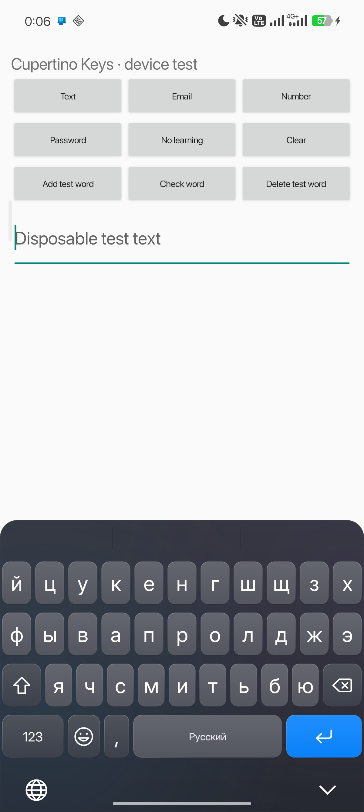
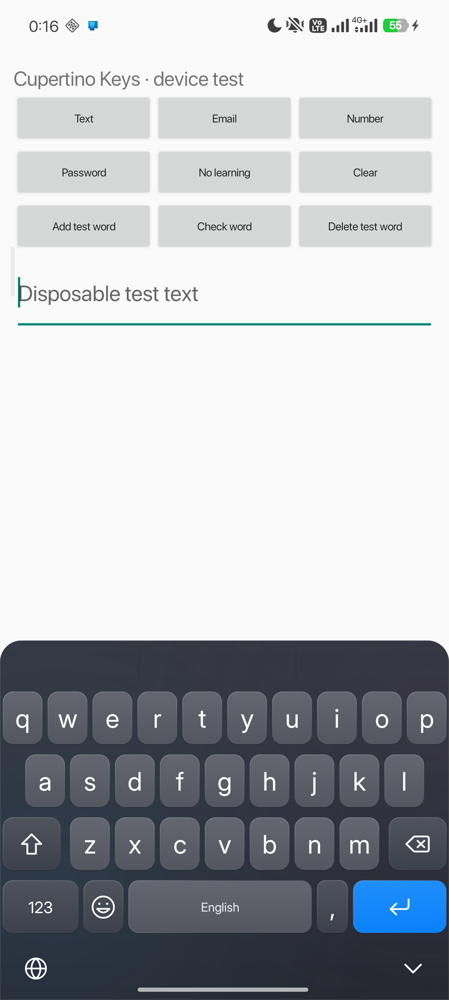

# Xiaomi 14: window geometry and bottom navigation

Device: Xiaomi 14 (23127PN0CG), Android 16 / API 36,
HyperOS OS3.0.305.0.WNCMIXM, 1200 x 2670 pixels, gesture navigation.
The work profile is managed by Shelter. Tests started late on November 20 and
continued on November 21 (Europe/Moscow).

Final APK SHA-256: `a03ef11b16d2131d8ffe4b4de57997094f0a2f0906107dedabdd5dde8f074d50`.

## Defects and fixes

The original native blur background used `InsetDrawable` with the keyboard's top
coordinate. Android treats that inset as window content padding. In the Android 16
regression test it changed the input height from 2560 to 784, the reported content
inset from 1760 to -16, and shifted the keys relative to the touch region. Both the
geometry and padding tests failed before the fix. The replacement drawable only
positions painting/outline bounds and has no layout padding or minimum size.

Physical-device testing also showed that Android's window blur covered the
application above the keyboard, even with an inset background outline. The platform
uses the outline's corner radius rather than its bounds for this effect. We now
require the visible keyboard to occupy the whole window before enabling native
blur. The regular full-height IME therefore uses the opaque frosted material.

Android 16's public `WindowInsets.Type.captionBar()` API replaces the IME-specific
bottom panel. A globe on the left cycles RU/EN; holding it opens the system IME
picker. The right button requests IME dismissal. The navigation/gesture bar itself
is not hidden. The custom panel is included in content and touchable insets.
It is enabled only for Cupertino colors with gesture navigation and a supported
caption bar, outside floating/fullscreen mode.

The custom panel owns the bottom navigation area, so that inset is removed only
from the insets dispatched to the keyboard's child views. This eliminates a second
48 px (16 dp) padding above the globe, without hiding or changing the system gesture
bar and without altering key sizes. The RU/EN alphabet layer also has a dedicated
comma immediately left of the spacebar, at the user's request.

## Automated results

- 23 Robolectric cases passed: 18 dictionary/default/privacy cases and 5 window/inset tests.
- 19 input/dictionary assertions passed on the phone.
- 11 navigation assertions passed: panel visibility, comma entry in both alphabets,
  button centers within the IME touch region, RU/EN cycling without insertion,
  dismissal and reopening.
- 4 geometry assertions passed: visible IME, zero decor top padding, no duplicate
  navigation padding and exact match of the reported content inset to the frame's top.
- Final geometry: decor 1200 x 2536; frame 1200 x 960 at (0, 1576); all decor
  paddings zero; custom footer 144 px; caption bar hidden; navigation inset 48 px.
  MainKeyboardView is 696 px tall with zero bottom padding, down from 744 px with
  an extra 48 px padding; occupied key geometry remains 696 px.
- APK assembly and source/merged-manifest privacy checks passed.
- Screenshot inspection confirmed a clear application above the keyboard and the
  globe/hide buttons in the bottom panel with the gesture indicator retained.

The on-device checks use the app's own instrumentation/View event dispatch. HyperOS
rejects ADB input injection (`INJECT_EVENTS`) and shell access to the work profile.
They are not a substitute for physical finger testing. No security setting or
Shelter policy was bypassed, and no separate keyboard copy was installed in Shelter.

## Manual verification

The user replied that the combined personal/Shelter manual check was OK (physical
key/globe/hide actions and `ctw` / `cupertinotestword` in a work app), then requested
a smaller gap and easier comma access. This is user-reported confirmation rather
than an independent work-profile instrumentation result. The subsequent comma and
gap changes passed the on-device checks above. The disposable dictionary entry was
removed successfully with `--phase work_cleanup`.

Landscape, three-button navigation and light-mode Android 16 visual checks are not
yet claimed as physically verified by this report.

## Bottom-panel refinement

Follow-up APK SHA-256: `464f547674832f6b2664a7ded2b4b56e117d7de245257cc42814bcd3145bff2e`.
Installed on Xiaomi 14 after the initial fix. The comma is now immediately **right**
of the spacebar in RU/EN. Bottom icons use 24 dp assets instead of 28 dp, with a
simpler globe and thinner strokes. Their centers move 8 dp toward the outside edges
and 4 dp upward, while both touch targets remain 48 x 48 dp in the IME caption area.

All 11 existing navigation checks and 4 geometry checks passed again on the phone.
The frame remains 1200 x 960 at (0, 1576), with no additional padding. The screenshot
was visually inspected in the disposable test screen; APK signature verification
passed. This pass changed only layout assets and did not rerun the unchanged JVM suite.

## References

- [InsetDrawable padding behavior](https://developer.android.com/reference/android/graphics/drawable/InsetDrawable)
- [Android 16 DecorView implementation](https://android.googlesource.com/platform/frameworks/base/+/refs/heads/android16-release/core/java/com/android/internal/policy/DecorView.java)
- [Public custom IME switcher/caption-bar API](https://developer.android.com/reference/android/inputmethodservice/InputMethodService#onCustomImeSwitcherButtonRequestedVisible(boolean))
